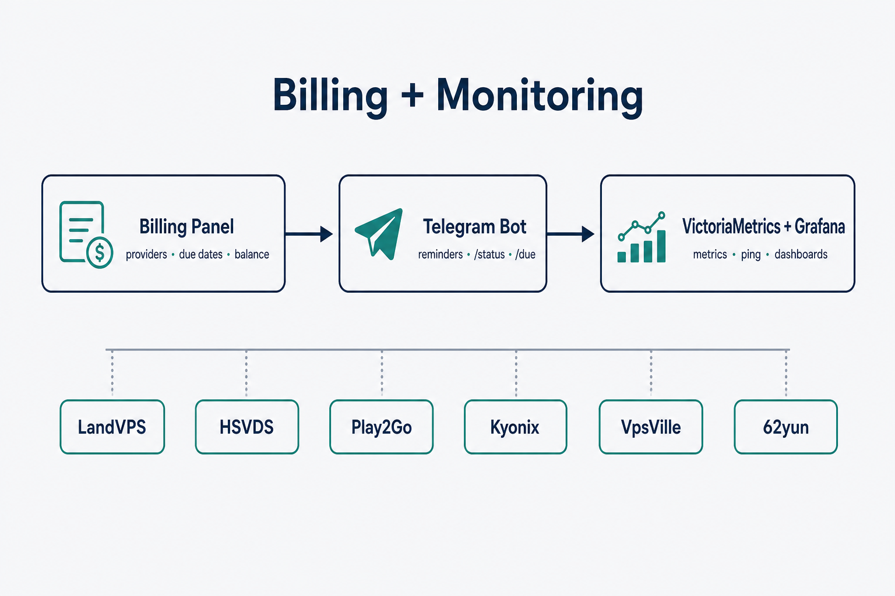
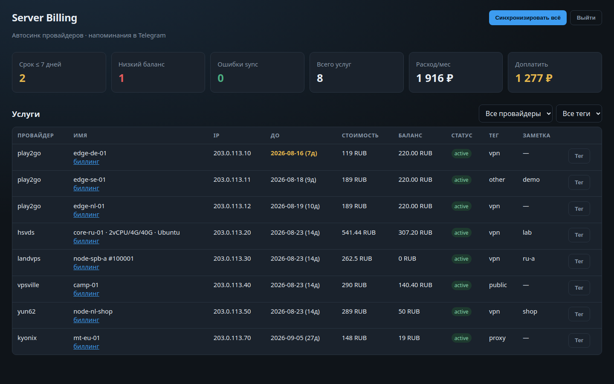
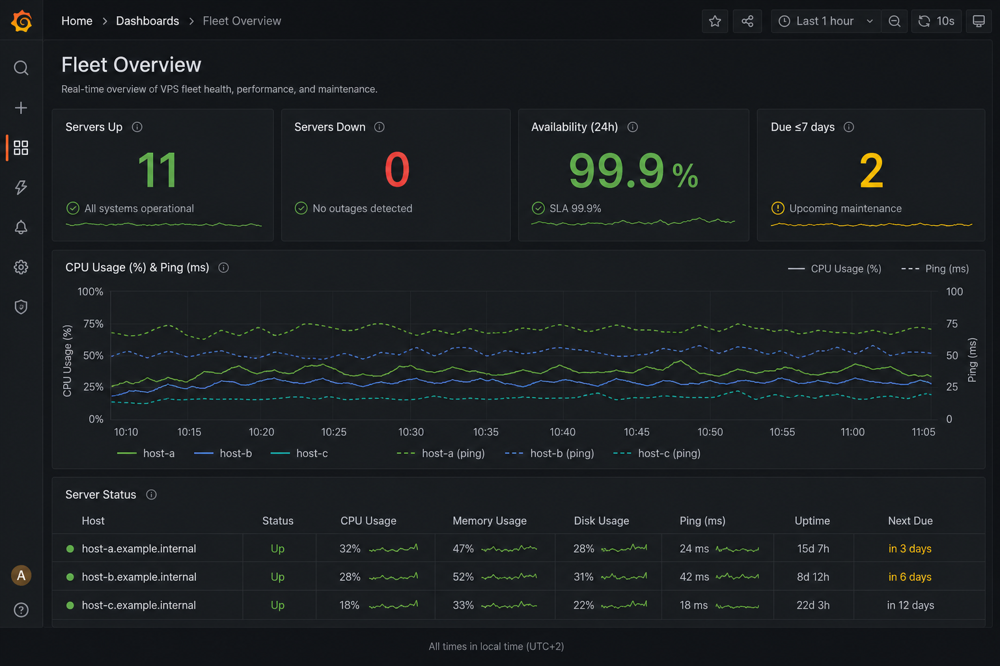

# Billing + Monitoring

Panel for **VPN / VPS fleet operators**: sync balances and due dates from hosting providers, remind you in Telegram, and optionally monitor hosts with VictoriaMetrics + Grafana.

No manual «paid» checkbox — after you pay at the provider, the next sync refreshes the data.

[Читать на русском](README.md)



## Features

- Multi-provider billing sync (API or Playwright)
- Encrypted provider credentials at rest (`CREDENTIALS_KEY`)
- Telegram reminders + fleet commands (`/list`, `/due`, `/sync`, `/status`, …)
- Optional monitoring: VictoriaMetrics, vmagent, Grafana, node_exporter, ICMP
- Docker-ready single-VPS deploy



## Hardware requirements

Estimate for **billing panel + monitoring stack** on one machine. Fleet size is not hard-capped by the software — it depends on CPU/RAM/disk and metrics retention.

| | Minimum | Recommended |
| --- | --- | --- |
| CPU | 1 vCPU | 2 vCPU |
| RAM | 1 GB (billing only) / 2 GB (billing + monitoring) | 2–4 GB |
| Disk | 10 GB SSD | 20+ GB SSD |
| OS | Linux x86_64, Docker 24+ or Node.js 20+ | Ubuntu 22.04+ |

Disk needs grow with VictoriaMetrics retention and scrape target count. On small disks, shorten `-retentionPeriod` in `monitoring/docker-compose.yml` and enable Docker log rotation.

## Providers

| ID | Method |
| --- | --- |
| `landvps` | BILLmanager API (`my.landvps.ru`) |
| `vpsville` | Playwright (client area) |
| `hsvds` | Playwright; due ≈ balance / daily spend |
| `play2go` | Billing panel login; optional Pterodactyl client key |
| `yun62` | Playwright (`62yun.ru`) |
| `kyonix` | JWT API on `beta.kyonix.com`; optional VMmanager (`vm.kyonix.com`) |

## Quick start (local)

```bash
cp .env.example .env
# Set PANEL_PASSWORD, CREDENTIALS_KEY (32+ chars), optional Telegram bot

npm install
npx playwright install chromium
npm run dev
```

Open http://localhost:3080 — password from `PANEL_PASSWORD`.

Add provider accounts → **Sync all**.

## Docker

```bash
cp .env.example .env
# edit .env
docker compose up -d --build
```

SQLite + Playwright sessions live under `./data` (gitignored).

## Telegram bot (your panel)

1. Create a bot with [@BotFather](https://t.me/BotFather).
2. Message `/start`, get `chat_id`.
3. Put in `.env`:

```env
TELEGRAM_BOT_TOKEN=...
TELEGRAM_CHAT_ID=...
```

Reminders: 7/3/1/0 days before `due_at`, and when balance ≤ `BALANCE_THRESHOLD` (default 500).

## Kyonix

- Primary: email + password for https://beta.kyonix.com → VDS, cost, next payment, balance.
- Optional: same credentials against https://vm.kyonix.com to merge VMs by id/IP/name.

## Monitoring



Grafana ships with several dashboards:

| Dashboard | Purpose |
| --- | --- |
| **Fleet Overview** | Fleet uptime, CPU/RAM, network by host |
| **Billing Ops** | Due dates, low balance, sync errors, spend |
| **Server Availability** | ICMP ping UP/DOWN, RTT by host |
| **Security Overview** | UFW blocks, fail2ban, top attacked hosts |

```bash
cp monitoring/.env.example monitoring/.env
cp monitoring/hosts/targets.example.json monitoring/hosts/targets.json
cp monitoring/hosts/ping-targets.example.json monitoring/hosts/ping-targets.json
# edit IPs/labels
npm run monitoring:up
```

Grafana: http://localhost:3000 · Billing metrics: http://localhost:3080/metrics

Details: [monitoring/README.md](monitoring/README.md)

## Security

- **Never commit** `.env`, `monitoring/.env`, `data/`, or real `targets.json` / `ping-targets.json`.
- See [SECURITY.md](SECURITY.md).

## Scripts

- `npm run dev` — development
- `npm run build && npm start` — production
- `npm run sync` — one-shot sync
- `npm run monitoring:up` — monitoring stack

## License

Free to **use and modify**, including for your own VPN/VPS business.  
**Selling** this software (as a product / paid SaaS of this code) is not allowed.

Full text: [LICENSE](LICENSE). Contact the author for a commercial sell license.
