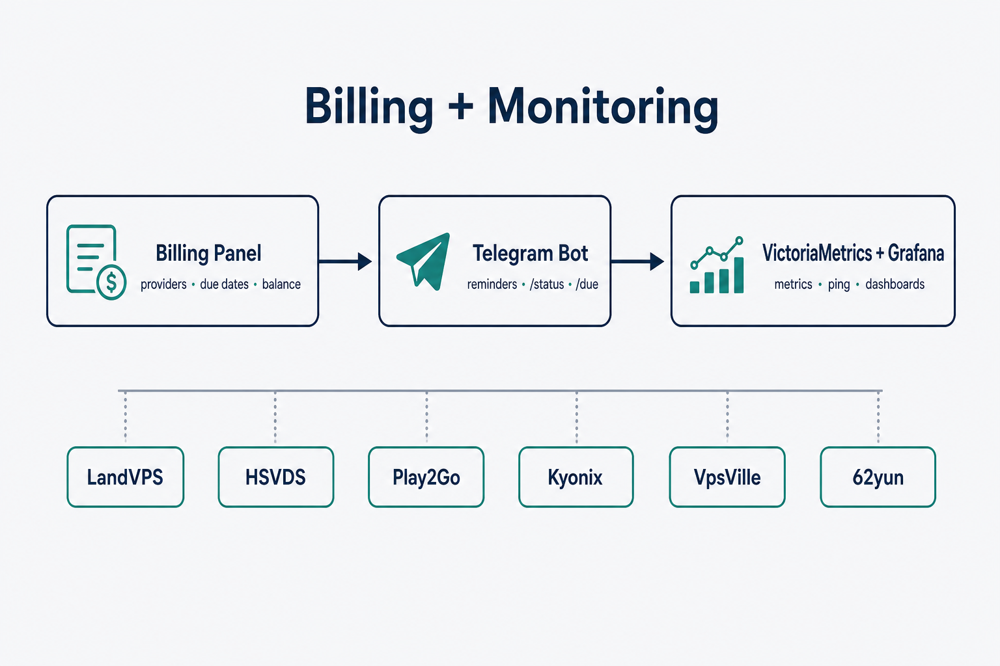
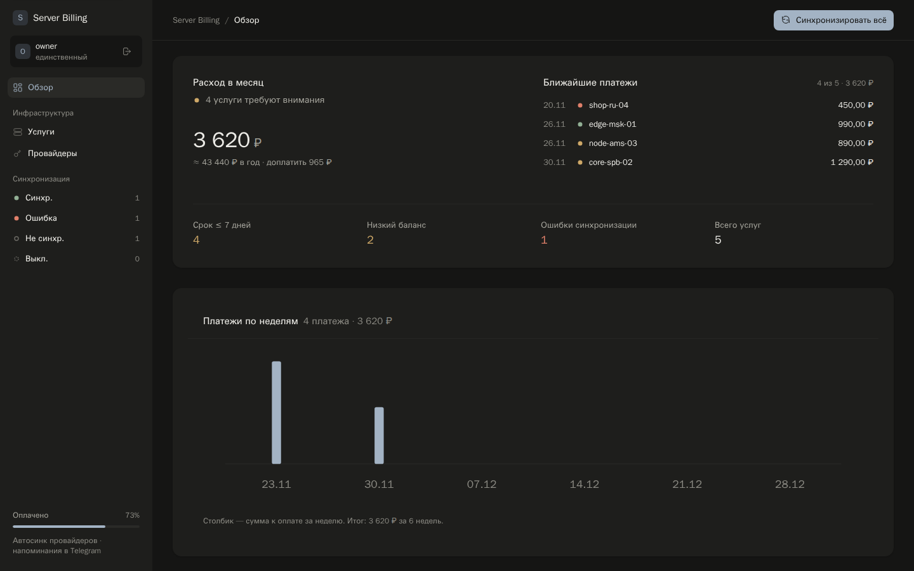
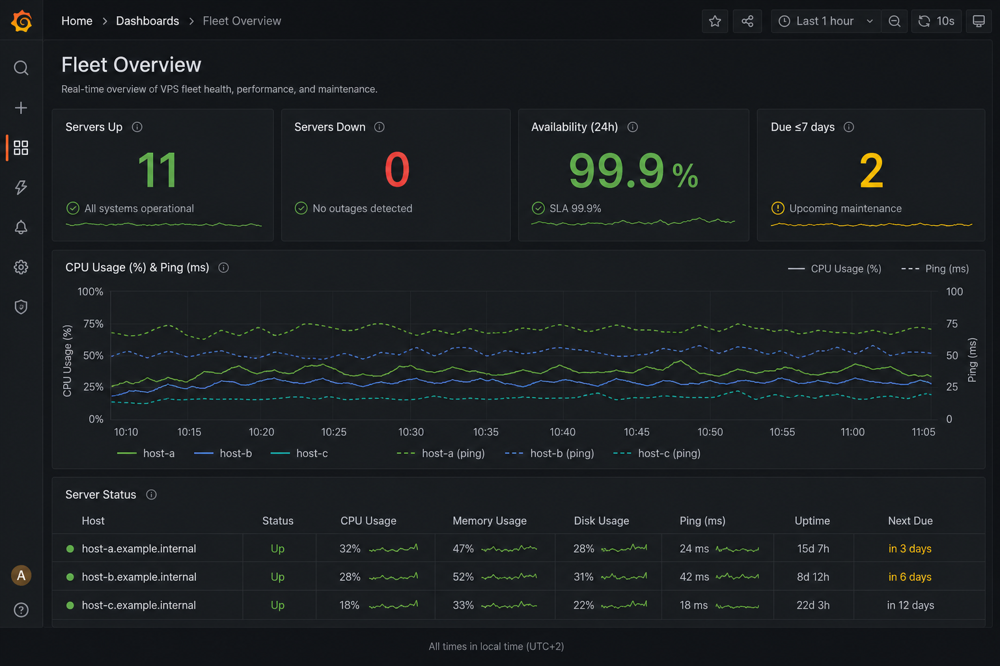

# Billing + Monitoring

Панель для **владельцев VPN / VPS-флотов**: сама забирает балансы и даты оплаты у хостеров, напоминает в Telegram и (по желанию) мониторит серверы через VictoriaMetrics + Grafana.

Ручной галочки «оплачено» нет — после оплаты у провайдера следующий sync обновляет данные.

[English README](README.en.md)



## Возможности

- Синхронизация нескольких провайдеров (API или Playwright)
- Креды провайдеров шифруются на диске (`CREDENTIALS_KEY`)
- Telegram: напоминания и команды флота (`/list`, `/due`, `/sync`, `/status`, …)
- Опциональный мониторинг: VictoriaMetrics, vmagent, Grafana, node_exporter, ICMP
- Деплой одной VPS через Docker



## Требования к железу

Оценка для **биллинг-панели + monitoring stack** на одной машине. Число хостов во флоте не ограничено софтом — упирается в CPU/RAM/диск и retention метрик.

| | Минимум | Рекомендуется |
| --- | --- | --- |
| CPU | 1 vCPU | 2 vCPU |
| RAM | 1 GB (только billing) / 2 GB (billing + monitoring) | 2–4 GB |
| Диск | 10 GB SSD | 20+ GB SSD |
| ОС | Linux x86_64, Docker 24+ или Node.js 20+ | Ubuntu 22.04+ |

Запас по диску зависит от retention VictoriaMetrics и числа scrape-целей. На маленьком диске укоротите `-retentionPeriod` в `monitoring/docker-compose.yml` и включите ротацию Docker-логов.

## Провайдеры

| ID | Способ |
| --- | --- |
| `landvps` | BILLmanager API (`my.landvps.ru`) |
| `vpsville` | Playwright (ЛК) |
| `hsvds` | Playwright; due ≈ баланс / суточный расход |
| `play2go` | Логин в биллинг; опционально Pterodactyl client key |
| `yun62` | Playwright (`62yun.ru`) |
| `kyonix` | JWT API `beta.kyonix.com`; опционально VMmanager (`vm.kyonix.com`) |

## Быстрый старт (локально)

```bash
cp .env.example .env
# PANEL_PASSWORD, CREDENTIALS_KEY (32+ символов), при желании Telegram

npm install
npx playwright install chromium
npm run dev
```

Открой http://localhost:3080 — пароль из `PANEL_PASSWORD`.

Добавь аккаунты провайдеров → **Синхронизировать всё**.

## Docker

```bash
cp .env.example .env
# отредактируй .env
docker compose up -d --build
```

SQLite и сессии Playwright лежат в `./data` (в git не попадают).

## Telegram-бот панели

1. Создай бота у [@BotFather](https://t.me/BotFather).
2. Напиши `/start`, узнай `chat_id`.
3. Пропиши в `.env`:

```env
TELEGRAM_BOT_TOKEN=...
TELEGRAM_CHAT_ID=...
```

Напоминания: за 7/3/1/0 дней до `due_at` и при балансе ≤ `BALANCE_THRESHOLD` (по умолчанию 500).

## Kyonix

- Основной путь: email + password на https://beta.kyonix.com → VDS, стоимость, дата оплаты, баланс.
- Опционально: те же креды на https://vm.kyonix.com для merge ВМ по id/IP/имени.

## Мониторинг



В Grafana из коробки несколько дашбордов:

| Дашборд | Для чего |
| --- | --- |
| **Fleet Overview** | Аптайм флота, CPU/RAM, сеть по хостам |
| **Billing Ops** | Сроки оплаты, низкий баланс, ошибки sync, расход |
| **Server Availability** | ICMP ping UP/DOWN, RTT по хостам |
| **Security Overview** | UFW blocks, fail2ban, атакованные хосты |

```bash
cp monitoring/.env.example monitoring/.env
cp monitoring/hosts/targets.example.json monitoring/hosts/targets.json
cp monitoring/hosts/ping-targets.example.json monitoring/hosts/ping-targets.json
# подставь свои IP и labels
npm run monitoring:up
```

- Grafana: http://localhost:3000  
- Метрики billing: http://localhost:3080/metrics  

Подробнее: [monitoring/README.md](monitoring/README.md)

## Безопасность

- **Не коммить** `.env`, `monitoring/.env`, `data/`, реальные `targets.json` / `ping-targets.json`.
- Пароль панели: `PANEL_PASSWORD`. Креды: AES-GCM + `CREDENTIALS_KEY`.
- См. [SECURITY.md](SECURITY.md).

## Скрипты

- `npm run dev` — разработка
- `npm run build && npm start` — production
- `npm run sync` — разовый sync всех аккаунтов
- `npm run monitoring:up` — поднять monitoring stack

## Лицензия

Свободно **использовать и изменять**, в том числе для своего VPN/VPS-бизнеса.  
**Продавать** это ПО (как продукт / платный SaaS из этого кода) — нельзя.

Полный текст: [LICENSE](LICENSE). Коммерческая лицензия на продажу — по договорённости с автором.

## Реферальные ссылки

Если проект был полезен, можно регистрироваться у хостеров по моим реферальным ссылкам:

- `vpsville` — [http://vpsville.ru/?ref=64224](http://vpsville.ru/?ref=64224)
- `hsvds` — [https://hsvds.ru/signup/?refid=20260304-2660750-252](https://hsvds.ru/signup/?refid=20260304-2660750-252)
- `62yun` — [https://62yun.ru/?refid=188175](https://62yun.ru/?refid=188175)
- `play2go` — [https://play2go.cloud/?ref_id=7STlUOlmq9E](https://play2go.cloud/?ref_id=7STlUOlmq9E)
- `kyonix` — [https://t.me/kyonix_bot?start=p48YNWCV](https://t.me/kyonix_bot?start=p48YNWCV)
- `landvps` — [https://landvps.ru/?from=23409](https://landvps.ru/?from=23409)

