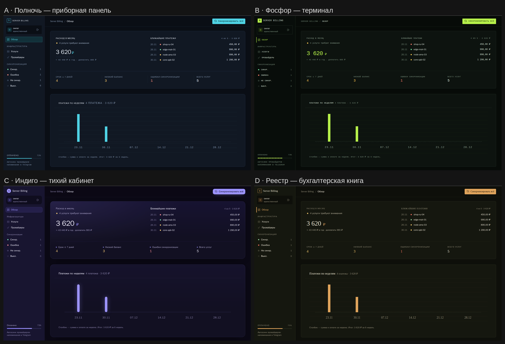
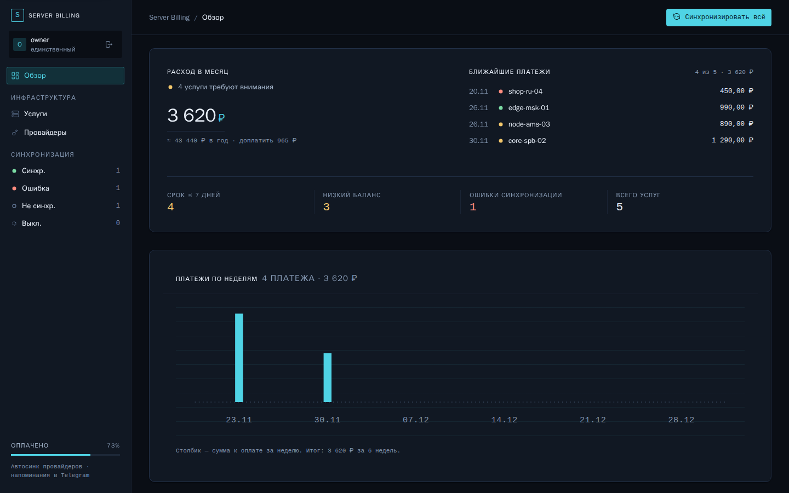
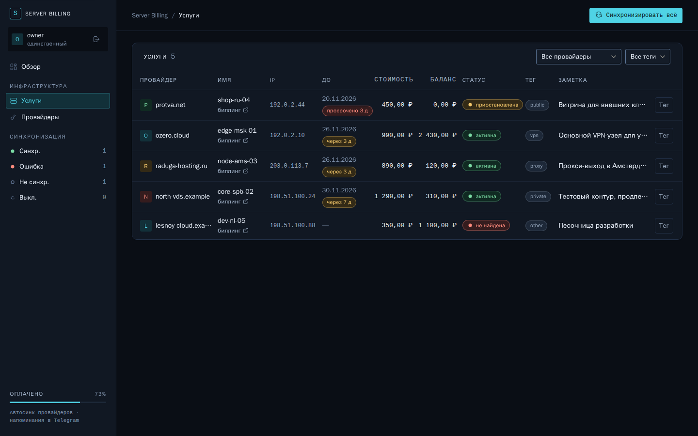
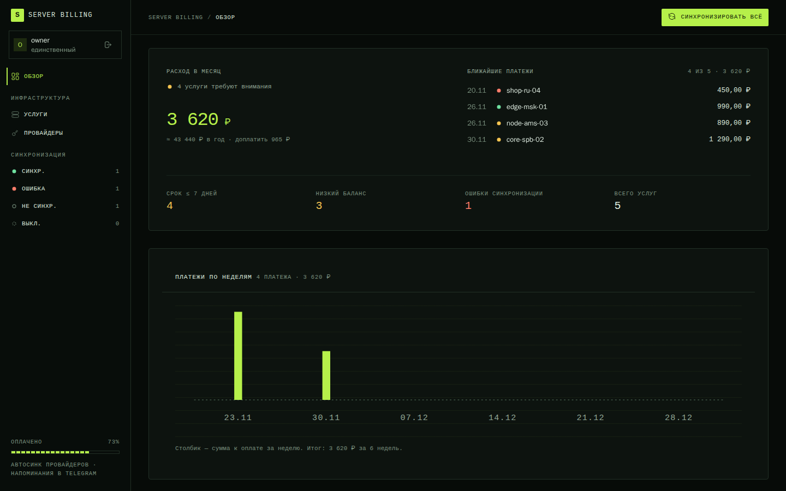
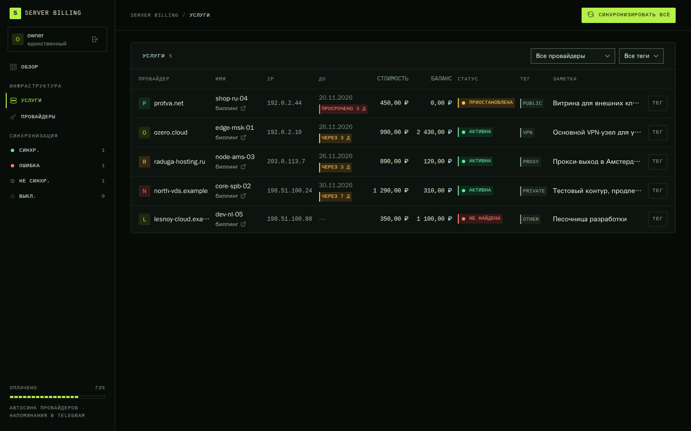
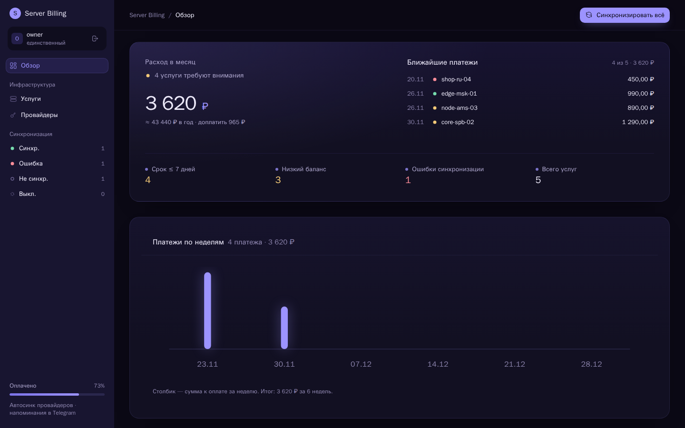
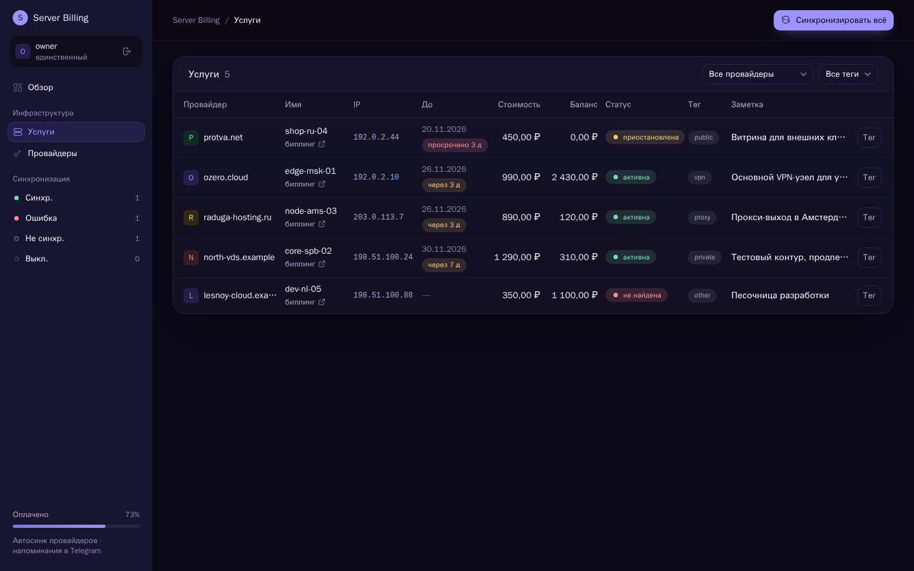
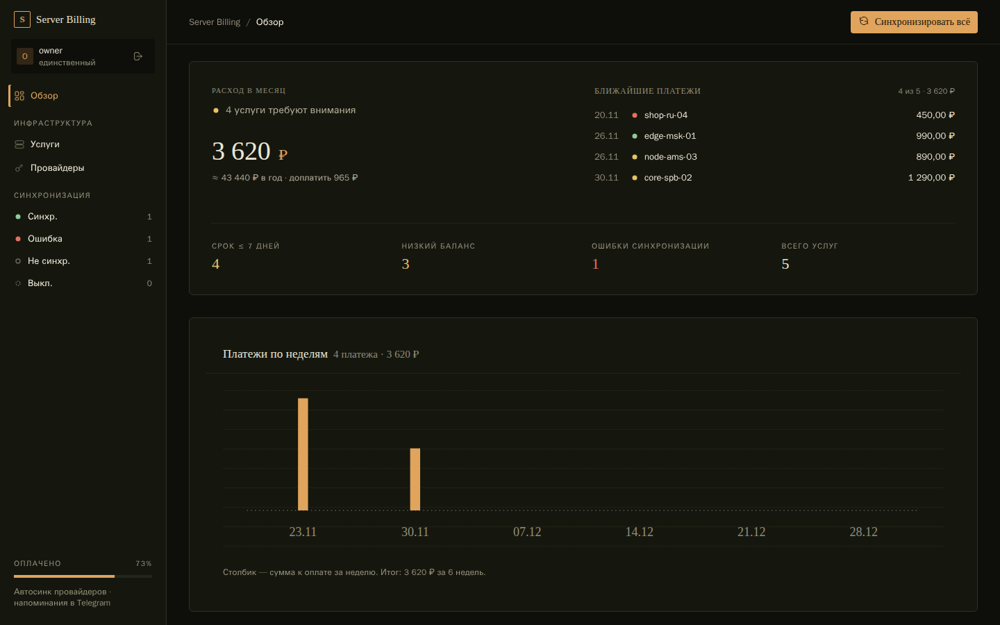
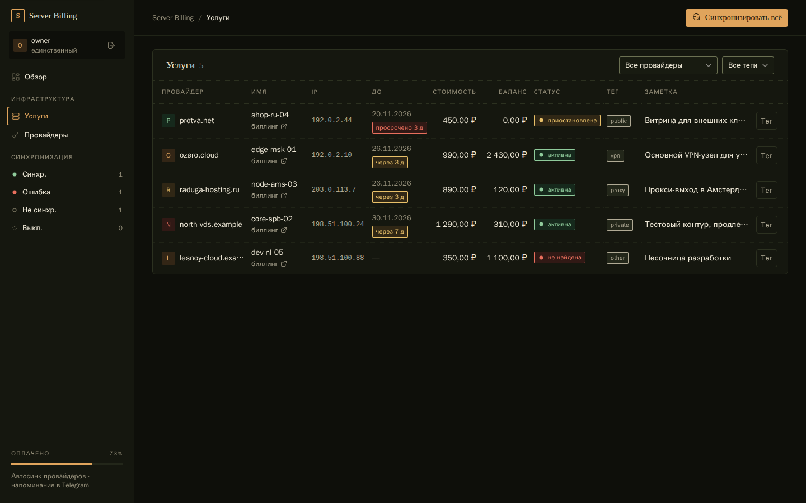

# Айдентика Server Billing: четыре цветовые концепции (только тёмная тема)

**Задача:** t1 — дать владельцу 3–4 варианта собственной визуальной айдентики вместо палитры,
которая читается как копия infra-billing.
**Что внутри:** 4 полных набора токенов, измеренные контрасты WCAG 2.1 AA, по два скриншота
реальной панели на вариант (1440×900), сравнительная таблица и рекомендация.
**Статус:** варианты готовы к выбору владельца. В `src/` ничего не менялось, коммитов нет.
**Файлы:** `docs/design/palette-<slug>.png` (вид «Обзор»), `docs/design/palette-<slug>-services.png`
(вид «Услуги»), `docs/design/variants/<slug>.css` — слой токенов и правил, которым сделан рендер,
`docs/design/contrast-palettes.mjs` — скрипт пересчёта контраста.

---

## 0. Коротко

| # | Вариант | Гамма поверхностей | Акцент | Характер в одном слове |
|---|---|---|---|---|
| A | **Полночь** (`midnight`) | сине-чёрная `#0A0E15` / `#111823` | ледяной циан `#4FD3E5` | прибор ночной смены |
| B | **Фосфор** (`phosphor`) | зелёно-чёрная `#070B08` / `#0D130F` | кислотный лайм `#B6F04A` | терминал дежурного |
| C | **Индиго** (`indigo`) | фиолетово-чёрная `#0B0915` / `#121022` | ирис `#9C93FF` | тихий вечерний кабинет |
| D | **Реестр** (`ledger`) | оливково-чёрная `#0E0F0A` / `#15170F` | медь `#E0A45C` | бухгалтерская книга |

**Рекомендация:** основной — **A «Полночь»**, смелый альтернативный — **B «Фосфор»**.
Обоснование в [§9](#9-рекомендация). C и D — спокойнее и теплее соответственно, если владелец
захочет другой тон.



*Слева направо, сверху вниз: A «Полночь», B «Фосфор», C «Индиго», D «Реестр». Полные скриншоты
1440×900 — ниже, в разделах вариантов.*

---

## 1. Почему текущая палитра читается как копия infra-billing

Это не ощущение, а совпадение значений. В `theirs/apps/frontend/src/index.css` (infra-billing
v0.58.1) блок `.dark` содержит ровно те же цвета, что стоят в `ours/src/public/style.css`:

| Слой | infra-billing `.dark` | ours (сейчас) |
|---|---|---|
| фон | `#151514` | `#151514` |
| карточка / сайдбар | `#1e1e1c` | `#1e1e1c` |
| поповер | `#232321` | `#232321` |
| hover / secondary | `#2a2a27` | `#2a2a27` |
| граница / hairline | `#2d2d2a` / `#262624` | `#2d2d2a` / `#262624` |
| основной текст | `#ecebe6` | `#ecebe6` |
| приглушённый | `#9e9d96` | `#a3a29a` |
| акцент-слейт | `#a3b3c4` | `#a3b3c4` |
| статусы | `#92b095` / `#cfa968` / `#e0806a` | те же |
| primary-кнопка | `#ecebe6` (костяная) | слейт `#a3b3c4` |

Владелец прав: палитра перенесена один в один, отличается только назначение слейта. Кроме цветов
скопированы и приёмы: нейтральный тёплый графит, пастельное трио статусов, радиусы 6/8/10/14,
бейджи 12 px sentence case, hairline-карточки без рамок, system sans везде, плоские столбики
графика на hairline-базлайне, elevation только тоном.

Что мы **не** трогаем (по условию задачи): сетку оболочки (sidebar 240, header 64), карточки,
таблицы, состав компонентов, отсутствие сборки, только тёмную тему, AA-дисциплину.

Что меняем в каждом варианте — пять осей, по которым infra узнаётся мгновенно:

1. **Температура и тон поверхностей** — все четыре варианта уводят нейтральный графит в свою
   гамму (синюю, зелёную, фиолетовую, оливковую).
2. **Акцент** — насыщенный цвет, которого у infra нет: он же primary-кнопка, ссылки, активный
   пункт, деньги и график.
3. **Типографика** — микро-капс, моно-цифры или антиква; у infra всё одним system sans.
4. **Формы** — пилюли, штампы, крупные мягкие радиусы или квадраты вместо универсальных 6–10 px.
5. **График и мелочи** — сетка, пунктирный базлайн, сегментная шкала, точечные линейки,
   свечение — то, чего в infra нет вообще.

---

## 2. Как измеряли и рендерили

**Рендер.** Панель поднята из этого же репозитория с одноразовым `DATA_DIR=/tmp/...` и
синтетическими данными `scripts/seed-demo.mjs` (3 вымышленных аккаунта, 5 услуг, 3 620 ₽/мес,
IP из RFC 5737). Боевой `src/public` не менялся: вариант подключался отдельным CSS-слоем
`docs/design/variants/<slug>.css` поверх работающей панели (инъекция `<link>` в страницу),
поэтому на скриншотах — настоящая вёрстка, настоящие компоненты и настоящие данные сида.
Скриншоты 1440×900, виды «Обзор» и «Услуги», Chromium, DPR 1.

**Контраст.** По WCAG 2.1: относительная яркость sRGB, порог 4.5:1 для обычного текста и 3:1 для
крупного текста и нетекстовых элементов (фокус-ринг, границы полей, столбики графика). Считались
не «на глаз», а скриптом `docs/design/contrast-palettes.mjs` — 31 пара на вариант плюс 5
композитных подложек у «Индиго», всего **129 проверок, все проходят**. Дополнительно ключевые элементы проверены на отрендеренной странице
через `getComputedStyle` с композитингом слоёв: для непрозрачных пар значения совпали с расчётом по
токенам, у «Индиго» полупрозрачные бейджи дополнительно пересчитаны по композиту над поверхностью
карточки (§6.3).

**Доступность сверх контраста.** Статус нигде не передаётся только цветом: в бейдже есть слово и
точка-глиф (1.4.1). Фокус — видимое кольцо 2 px с отступом, у полей — дополнительное мягкое
кольцо. Анимации наследуют существующий `prefers-reduced-motion`. Шрифты — только системные
стеки, без CDN и внешних файлов.

**Проверки, которые прогнаны:**

| Проверка | Результат |
|---|---|
| `node docs/design/contrast-palettes.mjs` | `checks: 129, failures: 0` |
| чистка `src/` | `git status --short` пуст, в `src/` нет правок |
| ширина бейджей в фиксированной таблице услуг (1120 px) | «приостановлена», «просрочено 3 д», теги — без переполнения |
| длинные бейджи в «Провайдерах» («не синхронизировался», 162 px) | влезают в ячейку 246–257 px, переполнений нет |
| консоль браузера после инъекции | без ошибок |

---

## 3. Референсы, которые смотрели (и почему не копировали)

1. [Pikka — 10 dark mode palettes for SaaS](https://pikka.app/blog/10-dark-mode-color-palette-ideas-for-saas-web-apps) —
   карта того, как выглядит «рынок»: obsidian+violet, midnight+cyan, graphite+mint, cyberpunk+lime,
   smoky quartz+periwinkle. Оттуда взято понимание клише; **не** взяты готовые пары. Ближе всего к
   тренду «Полночь» (navy+cyan), и это осознанно: циан приглушён до `#4FD3E5`, поверхности уведены
   в сине-чёрный, а идентичность держится не на цвете, а на приборах — моно-цифрах, сетке графика,
   микро-капсе и форме бейджей.
2. [NetSentinel AI — NOC/SOC design system](https://github.com/Aboulouafae-it/NetSentinel-AI/blob/main/docs/NETSENTINEL_UI_DESIGN_SYSTEM.md) —
   плотный статус-первый интерфейс: приглушённые капс-заголовки таблиц, левый рельс у критичных
   панелей, моно для IP, «карточки не светятся по умолчанию». Взято: статус-первый порядок
   акцентов, моно для IP, идея левого рельса (D) и левого зубца (B). Отвергнуто: чистый чёрный
   `#05070A` (halation) и корпоративный синий `#0EA5E9`.
3. [Paisa — financial UI spec](https://github.com/Pratap-kute/paisa/blob/master/docs/design/paisa-ui-spec.md) —
   «деньги и есть интерфейс», табличные цифры, запрет card soup, приоритет типографики над
   декором. Взято: табличные цифры и главенство суммы. Спорный пункт: Paisa запрещает моно для
   сумм; в A и B мы сознательно используем моноширинные цифры как приём — при табличных знаках и
   контрасте 9–14:1 они читаются лучше, чем кажется, и дают ту самую «приборность».
4. [Grafana design tokens](https://www.npmjs.com/package/@grafana/design-tokens) — семантические
   статус-токены и тёмные поверхности как индустриальный стандарт; использовано как проверка
   полноты набора (ok/warn/danger + их подложки, ring, field).
5. [VibeSDK — SaaS design skill (Stripe/Linear/Vercel lineage)](https://github.com/cloudflare/vibesdk/blob/32c9e429cd2712ea5959a89f65ae434162b89229/worker/agents/think/skills/frontend-design-saas/SKILL.md) —
   список приёмов «нейтрального SaaS», по которому infra и сделан. Использован как список того,
   чего избегать: градиентный текст, стеклянные панели, неон везде, синие пилюли статусов.
6. [Dusk design kit (dark)](https://github.com/wrongstack/wrongstack/blob/e195110437b7f3a33b261cbf23784cca428cca8c/packages/core/design-kits/dusk/KIT.md) —
   ещё один тёмный кит; подтвердил, что «ещё один нейтральный графит» ничего не даёт, и мы ушли в
   цветные поверхности.

Ни один вариант не повторяет референс: у каждого своя гамма, своя типографика и свои формы.

---

## 4. Вариант A — «Полночь» (`midnight`)

> Сине-чёрная ночь, ледяной циан, моно-цифры и сетка прибора.





### 4.1 Идея

Панель как пульт ночной смены: тёмный сине-чёрный корпус, один холодный сигнальный канал — циан —
и приборная типографика. Эмоция: собранность, тишина, контроль. Для владельца, который открывает
панель поздно, смотрит сумму и статусы и не хочет, чтобы интерфейс светил в лицо.

Циан горит только там, где есть действие или деньги: сумма валюты, ссылки, активный пункт,
кнопка синхронизации, столбики графика. Статусы живут отдельной тройкой (мята / янтарь / коралл)
и с акцентом не пересекаются. Суммы набраны моноширинным с табличными знаками, поэтому столбцы не
«пляшут»; сетка графика и микро-капс читаются как показания прибора.

### 4.2 Токены

**Поверхности и линии**

| Токен | Значение | Роль |
|---|---|---|
| `--bg` | `#0A0E15` | канва, фон шапки |
| `--surface` | `#111823` | карточки, сайдбар |
| `--surface-2` | `#17202E` | диалог, тост |
| `--surface-3` | `#1D2838` | hover, secondary |
| `--field` | `#141C28` | поля ввода |
| `--fail-bg` | `#311A1E` | строка с ошибкой |
| `--overlay` | `rgba(3,6,11,.62)` | подложка диалога |
| `--row-hover` | `rgb(79 211 229 / .05)` | подсветка строки |
| `--border` | `#223047` | границы карточек |
| `--hairline` | `#1A2434` | внутренние разделители |
| `--border-strong` | `#5B7495` | граница полей (нужно 3:1) |

**Текст и акцент**

| Токен | Значение | Роль |
|---|---|---|
| `--text` | `#E7EEF8` | основной текст |
| `--text-muted` | `#9FB0C6` | подписи, placeholder |
| `--text-dim` | `#8396B0` | мелкие мета-данные |
| `--text-faint` | `#5E7290` | только нетекст: иконки, disabled |
| `--accent` | `#4FD3E5` | ссылки, активный пункт, кнопка, график |
| `--accent-soft` | `#123039` | подложка активного пункта |
| `--accent-ink` | `#05161A` | текст на акцентной заливке |

**Статусы, фокус, график**

| Токен | Значение | Роль |
|---|---|---|
| `--ok` / `--ok-bg` | `#7BDBA4` / `#102A22` | «активна», успех |
| `--warn` / `--warn-bg` | `#F3C76B` / `#332A16` | «≤ 7 дней», внимание |
| `--danger` / `--danger-bg` | `#FF8B7E` / `#351C1E` | ошибка, удаление |
| `--danger-soft` | `rgb(255 139 126 / .18)` | кольцо поля с ошибкой |
| `--ring` / `--ring-soft` | `#5FDCEB` / `rgba(95,220,235,.22)` | фокус |
| `--chart-1` | `#4FD3E5` | деньги (столбики) |
| `--chart-2` | `#8FA8FF` | вторая серия |
| `--chart-3` | `#7BDBA4` | третья серия |

**Формы и шрифты:** радиусы 3/4/6/10/12 px; sans — system-ui; моно —
`"Liberation Mono", "SF Mono", "DejaVu Sans Mono", Menlo, Consolas, ui-monospace, monospace`
(без внешних файлов). Тени синие, а не нейтральные.

### 4.3 Измеренные контрасты

| Пара | Измерено | Порог | Итог |
|---|---|---|---|
| `--text` на `--bg` | 16.55:1 | 4.5 | OK |
| `--text` на `--surface` | 15.26:1 | 4.5 | OK |
| `--text-muted` на `--surface` | 8.06:1 | 4.5 | OK |
| `--text-dim` на `--surface` | 5.90:1 | 4.5 | OK |
| `--text-muted` на `--field` (placeholder) | 7.75:1 | 4.5 | OK |
| `--accent` на `--bg` | 10.84:1 | 4.5 | OK |
| `--accent` на `--accent-soft` (активный пункт) | 7.81:1 | 4.5 | OK |
| `--accent-ink` на `--accent` (primary) | 10.37:1 | 4.5 | OK |
| `--ok` на `--surface` | 10.61:1 | 4.5 | OK |
| `--ok` на `--ok-bg` (бейдж) | 9.09:1 | 4.5 | OK |
| `--warn` на `--surface` | 11.19:1 | 4.5 | OK |
| `--warn` на `--warn-bg` (бейдж) | 8.89:1 | 4.5 | OK |
| `--danger` на `--surface` | 7.84:1 | 4.5 | OK |
| `--danger` на `--danger-bg` (бейдж) | 6.92:1 | 4.5 | OK |
| `--danger` на `--fail-bg` (строка ошибки) | 7.13:1 | 4.5 | OK |
| `--ring` на `--bg` | 11.89:1 | 3 | OK |
| `--border-strong` на `--field` | 3.57:1 | 3 | OK |
| `--chart-2` / `--chart-3` на `--surface` | 7.82:1 / 10.61:1 | 3 | OK |

Минимальный запас — `--text-dim` на поверхности (5.90:1) и `--border-strong` на поле (3.57:1);
оба выше порога.

### 4.4 Айдентити-приёмы

1. **Микро-капс с трекингом.** `--summary-label`, `--kpi-label`, заголовки карточек, заголовки
   таблиц и группы навигации — uppercase 11 px, трекинг .08–.12em; вторичные подписи — моно 11 px.
2. **Приборная полоса KPI.** Вертикальные hairline-разделители между KPI, значения — моно 21 px.
   Сумма стоит на «рельсе»: тонкая линия под цифрой, валюта — циан.
3. **График-прибор.** Горизонтальная сетка на фоне SVG (шаг 26 px), квадратные столбики,
   пунктирный базлайн, моно-подписи дат.
4. **Формы.** Бейджи-пилюли с контуром статуса, чип активного пункта с внутренним контуром,
   бренд-марка — контурный квадрат с моно «S», кнопка синка — моно. Фокус — 2 px циан с отступом
   2 px, у полей — мягкое кольцо 3 px.

### 4.5 Чем отличается от infra-billing

- Поверхности уведены в сине-чёрный (`#0A0E15` / `#111823`), у infra — тёплый нейтральный
  `#151514` / `#1E1E1C`. Это первое, что видно, ещё до акцента.
- Акцент — насыщенный циан `#4FD3E5`, и он же primary-кнопка. У infra primary — костяная
  `#ECEBE6`, а слейт `#A3B3C4` живёт только в сайдбаре и ссылках.
- Статусы не пастельное трио infra: мята `#7BDBA4`, янтарь `#F3C76B`, коралл `#FF8B7E` — на
  холодных подложках, с пилюльной формой.
- Типографика: моно-цифры и капс-подписи вместо system sans; бейджи 11 px пилюлей вместо 12 px
  прямоугольников.
- График: сетка, пунктирный базлайн и квадратные столбики вместо плоских столбиков на hairline.

### 4.6 Риски

- Циан яркий (10.84:1 на фоне): на большой кнопке в тёмной комнате может казаться неоновым.
  Держать его на действиях и деньгах, не заливать крупные площади.
- Моно-цифры — характер, но в таблицах они шире пропорциональных; проверить плотность на 1280.
- Проверить на реальном мониторе при 100 % и 125 % масштабе.

---

## 5. Вариант B — «Фосфор» (`phosphor`)

> Зелёная чернота, кислотный лайм, терминальная типографика и квадратные штампы.





### 5.1 Идея

Терминал дежурного: зелёная чернота, кислотный лайм, моноширинные подписи, квадратные формы.
Эмоция: «я в терминале, всё под контролем». Для владельца, который любит текстовые интерфейсы и
хочет, чтобы панель выглядела как инструмент, а не как очередной SaaS.

Лайм — это «питание»: кнопка, активный пункт, столбики, сегментная шкала оплаты. Статусы —
мята / янтарь / коралл в квадратных штампах с левым зубцом. Подписи, навигация и цифры набраны
моно, поэтому панель читается как распечатка состояния флота.

### 5.2 Токены

**Поверхности и линии**

| Токен | Значение | Роль |
|---|---|---|
| `--bg` | `#070B08` | канва |
| `--surface` | `#0D130F` | карточки |
| `--surface-2` | `#111A14` | диалог, тост |
| `--surface-3` | `#16221A` | hover, secondary |
| `--field` | `#101812` | поля ввода |
| `--fail-bg` | `#2E1915` | строка с ошибкой |
| `--overlay` | `rgba(2,5,3,.68)` | подложка |
| `--row-hover` | `rgb(182 240 74 / .045)` | подсветка строки |
| `--border` | `#223026` | границы карточек |
| `--hairline` | `#18241C` | разделители |
| `--border-strong` | `#55705C` | граница полей |

**Текст и акцент**

| Токен | Значение | Роль |
|---|---|---|
| `--text` | `#DCE9DE` | основной текст |
| `--text-muted` | `#93A897` | подписи |
| `--text-dim` | `#7B917F` | мета-данные |
| `--text-faint` | `#5A6E5F` | нетекст |
| `--accent` | `#B6F04A` | лайм: кнопка, навигация, график, сумма |
| `--accent-soft` | `#1D2A10` | подложка |
| `--accent-ink` | `#101A05` | текст на лайме |

**Статусы, фокус, график**

| Токен | Значение | Роль |
|---|---|---|
| `--ok` / `--ok-bg` | `#6FE0A0` / `#0F2A1D` | «активна» |
| `--warn` / `--warn-bg` | `#F5C451` / `#332813` | внимание |
| `--danger` / `--danger-bg` | `#FF7D6B` / `#351A17` | ошибка |
| `--danger-soft` | `rgb(255 125 107 / .18)` | кольцо ошибки |
| `--ring` / `--ring-soft` | `#B6F04A` / `rgba(182,240,74,.2)` | фокус |
| `--chart-1` | `#B6F04A` | деньги |
| `--chart-2` | `#6FE0A0` | вторая серия |
| `--chart-3` | `#9BB8FF` | третья серия |

**Формы и шрифты:** радиусы 0–4 px (квадратная геометрия), sans — system-ui, моно — тот же
системный стек, что в A; тени почти без рассеивания.

### 5.3 Измеренные контрасты

| Пара | Измерено | Порог | Итог |
|---|---|---|---|
| `--text` на `--bg` | 15.80:1 | 4.5 | OK |
| `--text` на `--surface` | 15.00:1 | 4.5 | OK |
| `--text-muted` на `--surface` | 7.42:1 | 4.5 | OK |
| `--text-dim` на `--surface` | 5.55:1 | 4.5 | OK |
| `--text-muted` на `--field` | 7.14:1 | 4.5 | OK |
| `--accent` на `--bg` | 14.67:1 | 4.5 | OK |
| `--accent` на `--accent-soft` | 11.18:1 | 4.5 | OK |
| `--accent-ink` на `--accent` (primary) | 13.27:1 | 4.5 | OK |
| `--ok` на `--surface` | 11.50:1 | 4.5 | OK |
| `--ok` на `--ok-bg` | 9.38:1 | 4.5 | OK |
| `--warn` на `--surface` | 11.54:1 | 4.5 | OK |
| `--warn` на `--warn-bg` | 8.87:1 | 4.5 | OK |
| `--danger` на `--surface` | 7.52:1 | 4.5 | OK |
| `--danger` на `--danger-bg` | 6.40:1 | 4.5 | OK |
| `--danger` на `--fail-bg` | 6.63:1 | 4.5 | OK |
| `--ring` на `--bg` | 14.67:1 | 3 | OK |
| `--border-strong` на `--field` | 3.32:1 | 3 | OK |
| `--chart-2` / `--chart-3` на `--surface` | 11.50:1 / 9.57:1 | 3 | OK |

### 5.4 Айдентити-приёмы

1. **Моноширинная распечатка.** Навигация, группы, заголовки таблиц, KPI-подписи, подписи графика,
   суммы — моно; служебные подписи — uppercase 10.5–11 px с трекингом.
2. **Квадратные штампы и зубцы.** Бейдж — квадрат с левым зубцом (`inset 2px currentColor`),
   активный пункт — с левым лаймовым зубцом, шкала «Оплачено» — сегментная
   (`repeating-linear-gradient`).
3. **Сканлайны графика.** Лаймовые квадратные столбики, пунктирный базлайн, горизонтальные
   сканлайны на фоне SVG.
4. **Формы.** Радиусы 0–4 px, рамка вместо тени, кнопки-«команды» капсом, тёмный сайдбар с
   лаймовым квадратом бренда.

### 5.5 Чем отличается от infra-billing

- Поверхности — зелёно-чёрные (`#070B08` / `#0D130F`), у infra тёплый нейтральный графит.
- Акцент — кислотный лайм `#B6F04A` и он же primary; у infra primary костяной, статусы пастельные.
- Вся служебная типографика — моно и капс; у infra — sans sentence case.
- Бейджи-штампы с зубцом, сегментная шкала, сканлайны, нулевые радиусы — ни одного из этих
  приёмов в infra нет.
- Сайдбар темнее контента и с рамкой; у infra — тон-в-тон без границы.

### 5.6 Риски

- Лайм — самый громкий акцент из четырёх: длинные сессии могут утомлять, особенно на большой
  кнопке синка. Это осознанный «смелый» вариант, не повседневный по умолчанию.
- Моно-капс 10.5 px — минимальный кегль; проверить на 100 % масштабе и на 24" с большого
  расстояния.
- «Активна» (мята) и акцент (лайм) различаются оттенком; полагаться только на цвет нельзя —
  но в бейдже есть слово и точка, так что 1.4.1 соблюдён.

---

## 6. Вариант C — «Индиго» (`indigo`)

> Фиолетовая чернота, ирис, крупные мягкие формы и свет вместо рамок.





### 6.1 Идея

Тихий вечерний кабинет: фиолетовая чернота, ирис, крупные мягкие формы, свечение вместо рамок.
Эмоция: спокойствие, дорогой инструмент, не спеша. Для длинных вечерних сессий, когда хочется
меньше «сигнальных» цветов и больше воздуха.

Акцент — ирис; статусы — мята / янтарь / розовый коралл. Сумма набрана крупно и тонко (42 px,
вес 300), цифры «дышат»; перед KPI-подписями — точки-маркеры. Это самый мягкий вариант из четырёх
и самый «не-ops» по тону.

### 6.2 Токены

**Поверхности и линии**

| Токен | Значение | Роль |
|---|---|---|
| `--bg` | `#0B0915` | канва |
| `--surface` | `#121022` | карточки (градиент к `#16132C`) |
| `--surface-2` | `#181530` | сайдбар, диалог |
| `--surface-3` | `#1F1B3B` | hover |
| `--field` | `#15122A` | поля |
| `--fail-bg` | `#321A26` | строка ошибки |
| `--overlay` | `rgba(4,3,10,.6)` | подложка |
| `--row-hover` | `rgb(156 147 255 / .055)` | подсветка строки |
| `--border` | `#292350` | границы |
| `--hairline` | `#1D1838` | разделители |
| `--border-strong` | `#6B63A8` | граница полей |
| `--line-soft` | `rgb(156 147 255 / .12)` | лавандовый hairline карточек |

**Текст и акцент**

| Токен | Значение | Роль |
|---|---|---|
| `--text` | `#ECE9F9` | основной текст |
| `--text-muted` | `#A9A2C9` | подписи |
| `--text-dim` | `#8D85AE` | мета-данные |
| `--text-faint` | `#6A6190` | нетекст |
| `--accent` | `#9C93FF` | ирис: ссылки, кнопка, график |
| `--accent-soft` | `#241F4A` | подложка активного пункта |
| `--accent-ink` | `#0B0915` | текст на ирисе |

**Статусы, фокус, график**

| Токен | Значение | Роль |
|---|---|---|
| `--ok` / `--ok-bg` | `#77DCAE` / `#102A24` | «активна» |
| `--warn` / `--warn-bg` | `#F3C978` / `#322816` | внимание |
| `--danger` / `--danger-bg` | `#FF8E9A` / `#351C25` | ошибка |
| `--danger-soft` | `rgb(255 142 154 / .18)` | кольцо ошибки |
| `--ring` / `--ring-soft` | `#B0A8FF` / `rgba(176,168,255,.2)` | фокус |
| `--chart-1` | `#9C93FF` | деньги |
| `--chart-2` | `#77DCAE` | вторая серия |
| `--chart-3` | `#F0B8FF` | третья серия |

**Формы и шрифты:** радиусы 6/10/14/20/24 px; sans — system-ui; тени фиолетовые и глубокие;
шапка полупрозрачная с `backdrop-filter: blur(10px)`.

### 6.3 Измеренные контрасты

| Пара | Измерено | Порог | Итог |
|---|---|---|---|
| `--text` на `--bg` | 16.53:1 | 4.5 | OK |
| `--text` на `--surface` | 15.66:1 | 4.5 | OK |
| `--text` на верхней точке градиента карточки `#171331` | 14.98:1 | 4.5 | OK |
| `--text-muted` на `--surface` | 7.75:1 | 4.5 | OK |
| `--text-dim` на `--surface` | 5.43:1 | 4.5 | OK |
| `--text-muted` на `--field` | 7.55:1 | 4.5 | OK |
| `--accent` на `--bg` | 7.55:1 | 4.5 | OK |
| `--accent` на `--accent-soft` (активный пункт) | 5.86:1 | 4.5 | OK |
| `--accent-ink` на `--accent` (primary) | 7.55:1 | 4.5 | OK |
| `--ok` на `--surface` | 11.25:1 | 4.5 | OK |
| `--ok` на полупрозрачной подложке бейджа (композит `#202D36`) | 8.48:1 | 4.5 | OK |
| `--warn` на `--surface` | 11.97:1 | 4.5 | OK |
| `--warn` на композите бейджа `#322A2E` | 8.92:1 | 4.5 | OK |
| `--danger` на `--surface` | 8.54:1 | 4.5 | OK |
| `--danger` на композите бейджа `#362334` | 6.63:1 | 4.5 | OK |
| `--accent` на композите бейджа `#282545` | 5.57:1 | 4.5 | OK |
| `--ring` на `--bg` | 9.29:1 | 3 | OK |
| `--border-strong` на `--field` | 3.45:1 | 3 | OK |
| `--chart-2` / `--chart-3` на `--surface` | 11.25:1 / 11.58:1 | 3 | OK |

Бейджи «Индиго» — полупрозрачная заливка (14–16 %) поверх карточки, поэтому контраст считался по
скомпозитированному фону, а не по токену `--ok-bg`. Проверка на отрендеренной странице подтверждает
AA; там фон считается от канвы (более тёмной), поэтому в таблице оставлены консервативные значения —
по композиту над более светлой поверхностью карточки.

### 6.4 Айдентити-приёмы

1. **Свет вместо рамок.** Карточки — градиент от `#16132C` к `#121022` с лавандовым hairline 12 %;
   в главной карточке — радиальная «аврора»; шапка полупрозрачная с размытием.
2. **Мягкие цифры.** Сумма 42 px / вес 300, валюта — ирис; KPI-подписи с точкой-маркером; бейджи
   пилюлей с полупрозрачной подложкой; бренд-марка — круг.
3. **Свечение акцента.** Скруглённые столбики (rx 5) с мягким свечением, без сетки; активный
   пункт — скруглённая плашка с ирисовой подложкой; кнопки с мягкой тенью.
4. **Фокус.** 2 px ирис с отступом 3 px плюс мягкое кольцо; поля — 3 px кольцо.

### 6.5 Чем отличается от infra-billing

- Поверхности — фиолетово-чёрные, с градиентом и лавандовым hairline; у infra — плоский тёплый
  нейтральный графит без градиентов.
- Акцент — ирис `#9C93FF`; у infra акцента-бренда нет вовсе (слейт только в сайдбаре).
- Геометрия — 20 px карточки, 10 px кнопки, пилюли; у infra 6–14 px и прямоугольные бейджи.
- Свет и размытие (шапка, свечение графика, «аврора») — приёмов нет в infra.
- Полупрозрачные подложки бейджей вместо плотных `--ok-bg` / `--warn-bg` / `--danger-bg`.

### 6.6 Риски

- Свечение и `backdrop-filter` — декоративны и стоят производительности на слабом железе;
  предусмотреть непрозрачную шапку как fallback.
- Мягкость может читаться как «не ops»: для панели, где важно мгновенно увидеть аварию, это
  компенсируется статусами и точками, но требует проверки на реальных данных.
- Полупрозрачные бейджи требуют пересчёта контраста при смене поверхности (не переносить значения
  вслепую на другой фон).

---

## 7. Вариант D — «Реестр» (`ledger`)

> Оливковая чернота, медь, антиква в заголовках и сумме, точечные линейки и штампы.





### 7.1 Идея

Бухгалтерская книга: оливково-чёрная кожа, медь, антиква в заголовках и сумме, точечные линейки.
Эмоция: «это мой учёт», тепло и основательность. Для владельца, который воспринимает панель как
гроссбух: месяц, сумма, срок, отметка.

Медь — корешок книги и закладки: сумма, валюта, активный пункт, столбики графика. Статусы —
штампы с контуром. Таблицы остаются без засечек и с табличными цифрами, чтобы суммы не теряли
выравнивание; антиква живёт только в заголовках, сумме и KPI.

### 7.2 Токены

**Поверхности и линии**

| Токен | Значение | Роль |
|---|---|---|
| `--bg` | `#0E0F0A` | канва |
| `--surface` | `#15170F` | карточки, сайдбар |
| `--surface-2` | `#1B1E14` | диалог, тост |
| `--surface-3` | `#23271A` | hover |
| `--field` | `#181B11` | поля |
| `--fail-bg` | `#2E1A15` | строка ошибки |
| `--overlay` | `rgba(5,5,2,.66)` | подложка |
| `--row-hover` | `rgb(224 164 92 / .05)` | подсветка строки |
| `--border` | `#2C3120` | границы |
| `--hairline` | `#202417` | разделители |
| `--border-strong` | `#6B7052` | граница полей |

**Текст и акцент**

| Токен | Значение | Роль |
|---|---|---|
| `--text` | `#EDE7D6` | основной текст (костяной) |
| `--text-muted` | `#B0AA95` | подписи |
| `--text-dim` | `#948E79` | мета-данные |
| `--text-faint` | `#6E6A57` | нетекст |
| `--accent` | `#E0A45C` | медь: сумма, ссылки, кнопка, график |
| `--accent-soft` | `#332616` | подложка |
| `--accent-ink` | `#1A1206` | текст на меди |

**Статусы, фокус, график**

| Токен | Значение | Роль |
|---|---|---|
| `--ok` / `--ok-bg` | `#8FCB9B` / `#16291C` | «активна» |
| `--warn` / `--warn-bg` | `#E8C069` / `#302715` | внимание |
| `--danger` / `--danger-bg` | `#E86F5D` / `#311915` | ошибка |
| `--danger-soft` | `rgb(232 111 93 / .18)` | кольцо ошибки |
| `--ring` / `--ring-soft` | `#E8B472` / `rgba(232,180,114,.2)` | фокус |
| `--chart-1` | `#E0A45C` | деньги |
| `--chart-2` | `#8FCB9B` | вторая серия |
| `--chart-3` | `#C9B8FF` | третья серия |

**Формы и шрифты:** радиусы 2/4/6/8/10 px; антиква —
`"Iowan Old Style", "Palatino Linotype", Palatino, Georgia, "Times New Roman", "Liberation Serif", FreeSerif, serif`;
sans — system-ui; моно — системный стек; тени почти отсутствуют.

### 7.3 Измеренные контрасты

| Пара | Измерено | Порог | Итог |
|---|---|---|---|
| `--text` на `--bg` | 15.58:1 | 4.5 | OK |
| `--text` на `--surface` | 14.64:1 | 4.5 | OK |
| `--text-muted` на `--surface` | 7.78:1 | 4.5 | OK |
| `--text-dim` на `--surface` | 5.51:1 | 4.5 | OK |
| `--text-muted` на `--field` | 7.50:1 | 4.5 | OK |
| `--accent` на `--bg` | 8.83:1 | 4.5 | OK |
| `--accent` на `--accent-soft` | 6.74:1 | 4.5 | OK |
| `--accent-ink` на `--accent` (primary) | 8.50:1 | 4.5 | OK |
| `--ok` на `--surface` | 9.63:1 | 4.5 | OK |
| `--ok` на `--ok-bg` | 8.17:1 | 4.5 | OK |
| `--warn` на `--surface` | 10.48:1 | 4.5 | OK |
| `--warn` на `--warn-bg` | 8.53:1 | 4.5 | OK |
| `--danger` на `--surface` | 5.91:1 | 4.5 | OK |
| `--danger` на `--danger-bg` | 5.36:1 | 4.5 | OK |
| `--danger` на `--fail-bg` | 5.38:1 | 4.5 | OK |
| `--ring` на `--bg` | 10.26:1 | 3 | OK |
| `--border-strong` на `--field` | 3.38:1 | 3 | OK |
| `--chart-2` / `--chart-3` на `--surface` | 9.63:1 / 10.15:1 | 3 | OK |

Самый маленький запас — `--danger` на своей подложке (5.36:1). Медь и красный различаются оттенком
и формой (штамп), но это самый «горячий» угол палитры — при внедрении не снижать контраст
подложки.

### 7.4 Айдентити-приёмы

1. **Антиква в заголовках и деньгах.** Заголовки карточек, сумма, KPI — антиква; таблицы, подписи
   и цифры в таблицах — sans с табличными знаками, чтобы колонки не теряли выравнивание.
2. **Точечные линейки.** Dotted вместо solid: шапка карточки, строки таблицы, разделитель KPI,
   базлайн графика. Корешок 3 px меди на главной карточке.
3. **Штампы статусов.** Радиус 2 px, контур `currentColor` 1 px, sentence case — читается как
   отметка в книге. Бренд-марка — квадрат с медным контуром и антиквой; активный пункт — медная
   закладка слева.
4. **Фокус.** 2 px медное кольцо с отступом 2 px; у полей — мягкое кольцо.

### 7.5 Чем отличается от infra-billing

- Поверхности — оливково-чёрные (`#0E0F0A` / `#15170F`) вместо тёплого нейтрального графита.
- Акцент — медь `#E0A45C`, primary-кнопка — она же; у infra primary костяной.
- Антиква в заголовках и сумме — приёма нет в infra (там всё system sans).
- Точечные линейки, корешок на главной карточке, штампы статусов, «бумажные» линии графика.
- Радиусы 2–6 px, тени почти убраны, сайдбар с рамкой; у infra — 6–14 px, тени, сайдбар без рамки.

### 7.6 Риски

- Антиква зависит от системы: на Linux-сервере в стеке есть `Liberation Serif`, на macOS —
  `Iowan Old Style` / Georgia, на Windows — Georgia / Times. Метрики разные, сумма может «поехать»
  на 1–2 px — проверить на всех трёх ОС.
- Тёплая гамма ближе всех к infra по температуре: если владельцу критично «сразу видно, что не
  infra», отличие держится на оливе, меди и антикве, а не на контрасте холод/тепло.
- Dotted-линии на 1 px могут мерцать на не-ретина-мониторах; проверить на 100 %.

---

## 8. Сравнение

Оценки 1–5 — дизайнерская оценка по итогам рендера и замеров, не измерение.

| Критерий | A «Полночь» | B «Фосфор» | C «Индиго» | D «Реестр» |
|---|---|---|---|---|
| Отличие от infra по палитре | 5 | 5 | 5 | 4 |
| Отличие по приёмам и типографике | 5 | 5 | 4 | 5 |
| Читаемость цифр | 5 (моно, 15.26:1) | 5 (моно, лайм 13.92:1) | 5 (42 px/300, 15.66:1) | 4 (антиква в сумме, таблицы sans) |
| Различимость статусов | 5 | 4 (лайм ↔ мята) | 5 | 4 (медь ↔ красный) |
| Характер | прибор, собранность | терминал, азарт | кабинет, покой | книга, тепло |
| Усталость в тёмной комнате | 4 | 3 | 5 | 4 |
| Сложность внедрения | низкая | средняя | низкая | средняя |
| Главный риск | неоновость циана на большой площади | лайм утомляет, моно-капс мелкий | «слишком мягко» для аварий | антиква и тёплая гамма ближе к infra |
| Кому | дежурному ops | любителю терминала | вечерним сессиям | «гроссбуху» |

Что общего у всех четырёх (и чего нет у infra): цветные поверхности вместо нейтральных, свой
акцент-бренд, который является primary-кнопкой, отдельная типографическая система, собственные
формы бейджей и собственный график.

---

## 9. Рекомендация

### Основной: A «Полночь»

1. **Лучший баланс «своя гамма» и читаемость.** Сине-чёрные поверхности и циан нельзя спутать с
   тёплым нейтральным графитом infra; при этом все ключевые пары — 7.8–16.5:1, статусы 6.9–11.2:1.
2. **Статусы и акцент не конфликтуют.** Циан занят деньгами, навигацией и действиями. Мята /
   янтарь / коралл — только статусы. У B лайм и мята ближе по оттенку, у D медь и красный — тоже.
3. **Цифры — главные.** Моноширинные табличные цифры, «рельс» под суммой, приборная полоса KPI:
   владелец видит сумму и счётчики, а не декор.
4. **Достаточно тихо для тёмной комнаты.** Циан — один канал, а не заливка: он не превращает
   экран в неоновую вывеску (в отличие от B, где лайм — основной тон).
5. **Низкий риск внедрения.** Нет антиквы, нет blur и свечений, нет зависимости от метрик шрифта;
   системный sans + системный моно. Правила — в `variants/midnight.css`, переносятся в `style.css`
   без сборки.

### Смелый альтернативный: B «Фосфор»

Максимальный отрыв от infra: зелёная чернота, лайм, моно и штампы — панель выглядит как терминал,
а не как дашборд. Выбирать, если владелец хочет «вау» и готов к тому, что лайм будет самым
заметным цветом в комнате. Риски честно перечислены в §5.6; при внедрении поднять кегль
моно-подписей до 11–11.5 px и не заливать лаймом площади больше кнопки.

### Если хочется другого тона

- **C «Индиго»** — если приоритет «тихо и дорого», а не «пульт». Лучший вариант для долгих вечеров.
- **D «Реестр»** — если хочется тепла и «книги». Самый человечный, но и самый близкий к infra по
  температуре; антиква требует проверки на трёх ОС.

---

## 10. Что дальше (краткий бриф на внедрение)

1. Владелец выбирает вариант (основной + при желании смелый).
2. Перенести токены из `docs/design/variants/<slug>.css` в блок `:root` файла
   `src/public/style.css`; правила приёмов — в соответствующие секции (типографика, карточки,
   бейджи, таблицы, график, фокус), с комментариями.
3. Обновить `docs/DESIGN.md`: §2.1–2.3 (таблица токенов, готовый CSS-блок, измеренный контраст),
   §7 (чек-лист) — значения брать из этого документа и `contrast-palettes.mjs`.
4. Проверить то, что не попало в скриншоты: `login.html`, диалоги, тосты, пустые состояния,
   скелетоны, drawer, «Провайдеры» с длинным бейджем «не синхронизировался».
5. Прогнать `scripts/ui-smoke.sh`; снять 360 / 768 / 1280 / 1600; проверить фокус с клавиатуры,
   `prefers-reduced-motion`, зум 200 %.
6. Осторожно с фиксированной таблицей услуг при ≥1280: колонка статуса 11.5 %, бейджи не должны
   переноситься; длинные подписи — sentence case или компактный кегль (в этом документе проверено
   на 1440).
7. Никаких CDN, внешних шрифтов и картинок; только системные стеки.

---

## Приложение A. Пересчёт контраста

Скрипт: `docs/design/contrast-palettes.mjs` (Node, без зависимостей). Формула — WCAG 2.1:
линеаризация sRGB, `L = 0.2126R + 0.7152G + 0.0722B`, `(L1 + 0.05) / (L2 + 0.05)`.
Порог: 4.5:1 для текста, 3:1 для крупного текста и нетекстовых элементов.

```bash
cd ours && node docs/design/contrast-palettes.mjs
# ... 129 строк OK ...
# checks: 129, failures: 0
```

Скрипт печатает все пары по каждому варианту и строку `checks / failures`, ненулевой счётчик
означает провал. Для «Индиго» полупрозрачные бейджи в скрипте считаются по композиту
(12–16 % цвета поверх `--surface`); это те же значения, что в §6.3.

## Приложение B. Как получены скриншоты

```bash
cd ours
rm -rf /tmp/palette-demo && mkdir -p /tmp/palette-demo

# 1. сервер на одноразовых данных (порт 4399, чтобы не задеть другие сервисы)
PORT=4399 DATA_DIR=/tmp/palette-demo PANEL_PASSWORD=*** \
  SESSION_SECRET=*** CREDENTIALS_KEY=*** ./node_modules/.bin/tsx src/index.ts &

# 2. синтетические данные из Приложения А docs/DESIGN.md
node scripts/seed-demo.mjs /tmp/palette-demo

# 3. вход в браузере (Playwright), 1440×900
# 4. инъекция слоя варианта: <link rel="stylesheet" href="http://127.0.0.1:4401/midnight.css">
#    (статика отдавалась локальным http.server из docs/design/variants)
# 5. скриншоты: docs/design/palette-<slug>.png и palette-<slug>-services.png
```

Боевой `src/public` не менялся; одноразовые данные и серверы удалены после съёмки. На скриншотах
только синтетика из `seed-demo.mjs`: вымышленные провайдеры, IP из RFC 5737, суммы в рублях.

## Приложение C. Границы

- Скриншоты — только «Обзор» и «Услуги» на 1440×900. «Провайдеры», вход, диалоги и тосты
  используют те же токены, но отдельно не снимались; при внедрении их нужно проверить.
- Показана только тёмная тема; светлой палитры и переключателя нет по решению владельца.
- Сетка оболочки (sidebar 240, header 64, карточки, таблицы) не менялась — это рамка задачи.
- Слои `variants/*.css` — ревью-артефакт, а не продакшн-код: их нужно перенести в `style.css`
  осмысленно, а не подключить целиком.
- Оценки «характер», «усталость», «сложность» в §8 — дизайнерское суждение; измерены только
  контрасты и отсутствие переполнений.
