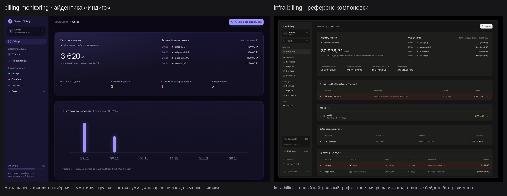

# Ревью t4: внедрение айдентики «Индиго» (палитра C)

**Verdict: PASS** (blocker/high нет; одна low-находка по документации).
**Дата:** 23.11.2026. **Ревьюер:** design-director. **Проверял:** t3 (внедрение в `src/public`).
**Вход:** `docs/DESIGN.md` (t2), `docs/design/variants/indigo.css`, `docs/design/palette-concepts.md` §6.
**Границы:** в рамках ревью изменялись только `docs/design/*` (этот отчёт и сравнение);
`src/public`, `scripts`, `docs/DESIGN.md` ревью не трогало (их текущие изменения — от t2/t3).

---

## 0. Коротко

| Критерий | Итог |
|---|---|
| Палитра и токены «Индиго» в `style.css` | **OK** — 22 ключевых токена совпадают с `variants/indigo.css`, старых хексов нет |
| Контраст на итоговом CSS | **OK** — минимум по тексту 5.13:1, по UI 3.34:1, бейджи 5.99–8.32:1, фокус 8.32–9.29:1 |
| Не клон infra-billing | **OK** — другая гамма, свет, формы, типографика; общая только компоновка (см. §3) |
| Спецификация ↔ CSS | **OK с оговоркой** — токены и все 48 пар §2.3 совпадают; вес главной цифры в доке 400, в CSS 300 (F1, low) |
| L1: подсказка горизонтального скролла | **OK** — 1280: 974/1120, градиент виден; 1600: переполнения нет, подсказки нет; страница не скроллится |
| Функции без регрессий | **OK** — build, `node --check`, ui-smoke (160 проверок) зелёные; ручной проход по UI без регрессий |
| `docs/images/billing-panel.png` | **OK** — 1440×900, «Индиго», синтетика, осмотрен (нюанс данных в §6) |

Сравнение бок-о-бок: 

---

## 1. Палитра и токены

### 1.1 Сверка трёх источников

`style.css` → `:root` (92 токена) сверен с `docs/design/variants/indigo.css` и спецификацией.

| Токен | variants/indigo.css | style.css | DESIGN.md §2.2 |
|---|---|---|---|
| `--bg` | `#0b0915` | `#0b0915` | `#0b0915` |
| `--surface` | `#121022` | `#121022` | `#121022` |
| `--surface-2` | `#181530` | `#181530` | `#181530` |
| `--surface-3` | `#1f1b3b` | `#1f1b3b` | `#1f1b3b` |
| `--field` | `#15122a` | `#15122a` | `#15122a` |
| `--border` | `#292350` | `#292350` | `#292350` |
| `--hairline` | `#1d1838` | `#1d1838` | `#1d1838` |
| `--border-strong` | `#6b63a8` | `#6b63a8` | `#6b63a8` |
| `--text` | `#ece9f9` | `#ece9f9` | `#ece9f9` |
| `--text-muted` | `#a9a2c9` | `#a9a2c9` | `#a9a2c9` |
| `--text-dim` | `#8d85ae` | `#8d85ae` | `#8d85ae` |
| `--text-faint` | `#6a6190` | `#6a6190` | `#6a6190` |
| `--accent` | `#9c93ff` | `#9c93ff` | `#9c93ff` |
| `--accent-soft` | `#241f4a` | `#241f4a` | `#241f4a` |
| `--accent-ink` | `#0b0915` | `#0b0915` | `#0b0915` |
| `--ok` / `--ok-bg` | `#77dcae` / `#102a24` | `#77dcae` / `#102a24` | те же |
| `--warn` / `--warn-bg` | `#f3c978` / `#322816` | `#f3c978` / `#322816` | те же |
| `--danger` / `--danger-bg` | `#ff8e9a` / `#351c25` | `#ff8e9a` / `#351c25` | те же |
| `--ring` / `--ring-soft` | `#b0a8ff` / `rgba(176,168,255,.2)` | `#b0a8ff` / `rgba(176,168,255,.2)` | те же |
| `--chart-1/2/3` | `#9c93ff` / `#77dcae` / `#f0b8ff` | те же | те же |

Проверка скриптом: `core palette vs variants/indigo.css mismatches: []`.

Реализация уточняет служебные токены относительно ревью-слоя (это согласовано со спецификацией):
`--border-strong` для границ полей вместо слабого `--border`, подложки бейджей вынесены в
`--badge-*-bg` (вместо rgba-литералов), добавлены `--line-soft/--row-line/--active-line/
--header-line/--sticky-bg/--grad-*/--glow-*`. Блок `:root` в `style.css` **побайтово
(нормализованно) совпадает** с §2.2 `DESIGN.md`: 92 токена, 0 расхождений.

### 1.2 Старые хексы

`grep` по `src/public`:

```
#151514|#1e1e1c|#232321|#2a2a27|#262624|#2b1f1b|#2d2d2a|#72716a|#ecebe6|
#a3a29a|#8b8a83|#6c6b65|#a3b3c4|#2f3338|#92b095|#26332a|#cfa968|#38301e|#e0806a|#3a2621
→ none
```

### 1.3 Айдентика на рендере (computed styles)

| Приём | Факт в браузере (1440×900) |
|---|---|
| Поверхности | `body` `rgb(11,9,21)`, текст `rgb(236,233,249)` |
| Карточка | радиус 20px, граница `rgba(156,147,255,.12)`, градиент + «аврора» у сводки, тень `0 18px 48px -32px` |
| Главная цифра | 42px, **вес 300**, tracking −0.028em; валюта 20px `rgb(156,147,255)` |
| KPI | 20px/400, точки-маркеры `--accent` перед подписями |
| Шапка | `rgba(11,9,21,.82)`, нижняя граница `rgba(156,147,255,.09)`, `backdrop-filter: blur(10px)` |
| Активный пункт | плашка `rgb(36,31,74)`, контур inset 1px `rgba(156,147,255,.16)`, радиус 10px |
| Бейджи | height 22px, радиус 999px, 11px, полупрозрачные подложки, точка наследует цвет |
| Поля | height 40px, радиус 10px, граница `rgb(107,99,168)` |
| График | столбики `rx=5`, `fill: #9c93ff`, `drop-shadow(... 9px)`, базлайн `rgba(156,147,255,.12)` |
| Фокус | 2px solid `rgb(176,168,255)`, offset 3px |

---

## 2. Контраст на итоговом CSS

Метод: WCAG 2.1 (sRGB), значения посчитаны по итоговому `:root` из `style.css`; полупрозрачные
бейджи — по композиту поверх подложки; текст на градиентах — по верхней (самой светлой) точке.

### 2.1 Минимумы

| Что | Минимум | Где |
|---|---|---|
| Текст | **5.13:1** | `--text-dim #8d85ae` на `--surface-2 #181530` (счётчики/заметки сайдбара) |
| Текст на градиенте | 5.24:1 / 5.20:1 | `--text-dim` на верху `--grad-card #16132c` / `--grad-summary #171331` |
| Основной текст | 15.66:1 | `--text` на `--surface` (на «авроре» — 12.62:1) |
| UI (границы/ринги/график) | **3.34:1** | `--border-strong #6b63a8` на `--surface-2` (поле в диалоге); на `--field` 3.45:1, на `--surface` 3.54:1 |
| UI-иконки | **3.13:1** | `--text-faint #6a6190` на `--surface-2` (иконки сайдбара; нетекст) |
| Фокус-ринг | 8.32–9.29:1 | `--ring #b0a8ff` на surface-2 / surface / bg |
| Столбики графика | 7.15:1+ | `--chart-1/2/3` на `--surface` |

Пороги: текст 4.5:1, UI/бейджи 3:1 — соблюдены с запасом (минимум текста выше порога в 1.14
раза). Независимый пересчёт совпадает со скриптом t3 `scripts/contrast-indigo.mjs`
(33 пары, `min text: 5.24:1, min ui: 3.13:1, failures: 0`).

### 2.2 Бейджи ok/warn/danger — на рендере

Замерено в браузере (`getComputedStyle` + композит над худшей подложкой `--surface-2`):

| Бейдж | Текст | Подложка | Контраст (surface-2 / surface) |
|---|---|---|---|
| `активна` (ok) | `rgb(119,220,174)` | rgba(119,220,174,.14) | **7.92 / 8.52** |
| срок (warn) | `rgb(243,201,120)` | rgba(243,201,120,.14) | **8.32 / 8.94** |
| ошибка/просрочено (danger) | `rgb(255,142,154)` | rgba(255,142,154,.15) | **6.19 / 6.64** |
| тег (neutral) | `rgb(169,162,201)` | rgba(169,162,201,.12) | **5.99 / 6.43** |

Плюс проверка по спецификации (композит над `--surface`): ok 8.48, warn 8.92, danger 6.63,
accent 5.57, neutral 6.41 — все ≥4.5:1.

### 2.3 Фокус

Реальный Tab-проход: первый фокус — skip-link, `outline: 2px solid rgb(176,168,255)`,
`outline-offset: 3px` → видим на всех поверхностях (8.32–9.29:1 при пороге 3:1).
Поля дополнительно получают `box-shadow: 0 0 0 3px var(--ring-soft)`.

---

## 3. Отличие от infra-billing

### 3.1 Палитра

| Слой | infra-billing (`.dark`) | «Индиго» (наша панель) |
|---|---|---|
| Фон | `#151514` тёплый нейтральный | `#0B0915` фиолетово-чёрный |
| Карточки | `#1E1E1C`, плоские | `#121022` + градиент от `#16132C`, «аврора» |
| Сайдбар | `#1E1E1C` без границы | `#181530` (светлее канвы) |
| Акцент | слейт `#A3B3C4` только в навигации/ссылках; primary — костяная `#ECEBE6` | ирис `#9C93FF` — primary-кнопка, ссылки, активный пункт, график |
| Статусы | `#92B095` / `#CFA968` / `#E0806A` на плотных подложках | `#77DCAE` / `#F3C978` / `#FF8E9A` на полупрозрачных 14–15 % |
| Текст | `#ECEBE6` / `#9E9D96` / `#6C6B65` | `#ECE9F9` / `#A9A2C9` / `#8D85AE` |

### 3.2 Приёмы

| Приём | infra-billing | «Индиго» |
|---|---|---|
| Радиусы | 6–14px | 10–24px (карточка 20, диалог 24) |
| Бейджи | прямоугольники 6px, плотный фон | пилюли 999px, полупрозрачные подложки, 11px |
| Свет | плоские поверхности, тень 1–2px | градиент карточки, «аврора» сводки, `backdrop-filter` на шапке, свечение столбиков и primary-кнопки |
| Типографика | 34/400, без акцентов | 42/300, валюта ирисом, точки у KPI |
| Поля/кнопки | 36px, радиус 8px | 40px, радиус 10px |
| График | плоские столбики, hairline | `rx=5`, drop-shadow, базлайн ирисовый 12 % |
| Активный пункт | заливка `#2A2A27` | плашка `#241F4A` + контур 1px |

### 3.3 Сравнение бок-о-бок

`review-t4-compare.png` (слева — наша панель, справа — `theirs/docs/screenshot-dark.webp`):

**Вывод: панель не читается как копия.** Общая осталась только компоновка (сайдбар 240,
шапка 64, карточки, плотные таблицы) — это решение владельца. Всё, что создаёт айдентику,
отличается: температура канвы (фиолетовая vs тёплая нейтральная), акцент (ирис vs костяная
primary-кнопка), свет (градиенты/«аврора»/blur/свечение vs плоские поверхности), формы
(пилюли и 20–24px vs прямоугольники и 6–14px), типографика (тонкая крупная сумма с ирисовой
валютой vs 34/400). Совпадений хексов нет ни одного — это проверено grep'ом.

---

## 4. Спецификация и реализация

- `DESIGN.md` §2.2 ↔ `style.css :root`: **92/92 токена, значения совпадают** (нормализованное
  сравнение — `True`).
- §2.3 ↔ CSS: **48/48 строк контраста** пересчитаны по фактическим токенам — 0 расхождений.
- §7: 38 критериев на месте; строки #4 (активный пункт — `--accent-soft` + `--active-line`) и
  #13 (42px) соответствуют коду; пороги и блоки не ослаблены. Бюджет CSS #33: 879 строк
  (600–900) — OK.
- **F1 (low):** вес главной цифры. `style.css` — `font-weight: 300` (совпадает с выбранной
  концепцией C, `palette-concepts.md` §6.1), а в `DESIGN.md` осталось `400` в §2.4 (таблица и
  правило «веса — 400 у текста и цифр»), §2.7 и §7 #13. Это расхождение документации, не кода:
  правка — 4 строки в `DESIGN.md` (вне scope t4), на AA и функциональность не влияет.
- Слой `variants/indigo.css` (артефакт t1) по служебным токенам отличается от реализации
  (`--border` для полей вместо `--border-strong`, rgba-подложки бейджей вместо токенов,
  другие имена линий/градиентов). Это ожидаемо: слой — ревью-артефакт, источник истины для
  внедрения — `DESIGN.md`; ключевая палитра совпадает полностью.

---

## 5. L1: подсказка горизонтального скролла

| Ширина | `.table-wrap` client/scroll | `data-scrollable` | Подсказка `::after` | Страница |
|---|---|---|---|---|
| 1280 | 974 / 1120 (146px) | `true` | градиент `linear-gradient(90deg, rgba(11,9,21,0), rgba(11,9,21,.85))`, 24px | `body.scrollWidth = 1280 = innerWidth` — нет скролла |
| 1280, прокрутка в конец | 974 / 1120, scrollLeft 146 | `null` (снят) | скрыта | — |
| 1600 | 1294 / 1294 | `null` | `content: none` | `body.scrollWidth = 1600` |

Подсказка привязана к фактическому переполнению (`syncTableOverflow` + ResizeObserver/scroll/
resize/rAF), а не к брейкпоинту; при отсутствии переполнения не рисуется. Требование «видна при
≥1280 при переполнении» выполнено.

---

## 6. Функциональность и скриншот

### 6.1 Обязательные проверки

| Команда | Итог |
|---|---|
| `npm run build` | exit 0 (`tsc` без ошибок) |
| `node --check src/public/app.js` | OK |
| `bash scripts/ui-smoke.sh` | **all UI smoke checks passed**, 160 `ok`, 0 fail (включая runtime на синтетике) |
| `node scripts/contrast-indigo.mjs` | 33 пары, `min text 5.24:1`, `min ui 3.13:1`, `failures: 0` |

### 6.2 Ручной проход по UI (Chromium, DATA_DIR в `/tmp`, seed-demo)

| Сценарий | Результат |
|---|---|
| Вход по паролю | 200 → `#/overview`, сайдбар/виды на месте |
| Выход | редирект `/login`, форма входа |
| Deep links | `#/services` после reload — вид/крошка/активный пункт; неизвестный hash → `#/overview` |
| Фильтры | провайдер protva.net → 5→1, «Сбросить» появился; + тег vpn → 0; сброс → 5 |
| Тег/заметка | диалог открылся, сохранение → тост «Изменения сохранены», API: tag `wheelko`, notes `review note` |
| Sync all | кнопка блокируется/восстанавливается, тост «Синхронизировано: 0 аккаунтов, 3 ошибки» (вымышленные провайдеры) |
| Per-account sync | тост «Синхронизация не удалась: No adapter…», кнопка восстановлена, UI не падает |
| Add account | форма → аккаунт создан, тост «Аккаунт добавлен» |
| Delete account | подтверждение → аккаунт удалён, тост «Аккаунт удалён» |
| Фокус с клавиатуры | skip-link, ring 2px/offset 3px |

Синхронизация вымышленных провайдеров ожидаемо возвращает ошибку (`No adapter` / 500 в сети) —
это данные сида, а не регрессия: UI показывает тост, состояние восстанавливается.

### 6.3 `docs/images/billing-panel.png`

1440×900, PNG 187 056 B, «Индиго»: фиолетовая канва, ирис, «аврора», тонкая сумма 42/300,
KPI-точки, свечение графика; данные синтетические (3 620 ₽, 4 из 5, вымышленные имена, IP не
видны). Осмотрен, соответствует текущему рендеру.

Нюанс (не дефект): на скриншоте «Низкий баланс 2», при дефолтном `BALANCE_THRESHOLD=500` свежий
seed даёт 3 (310 ₽ тоже ниже порога); 2 получается при `BALANCE_THRESHOLD=200` (как в ui-smoke).
Стоит при следующем обновлении доков зафиксировать конфиг съёмки в Приложении А — сейчас там
уже стоит «2», что совпадает со скриншотом, но не с дефолтным запуском.

---

## 7. Находки

| ID | Severity | Проблема | Где | Required fix |
|---|---|---|---|---|
| F1 | **low** | Вес главной цифры в спецификации 400, в CSS 300 (выбранная концепция C — 300) | `docs/DESIGN.md` §2.4 (таблица + правило), §2.7, §7 #13 | Синхронизировать 4 значения на `300` отдельной правкой доков (вне scope t4); код не трогать |

Блокирующих и high-находок нет. F1 не влияет на WCAG AA, функциональность и выбранную
айдентику (CSS соответствует концепции владельца), поэтому verdict — pass.

---

## 8. Verdict

**PASS.** Айдентика «Индиго» внедрена точно по палитре и приёмам, доступна по WCAG AA на
итоговом CSS, визуально не является копией infra-billing, L1-полиш закрыт, регрессий функций
не найдено; build, `node --check` и `ui-smoke.sh` зелёные. Единственная находка — расхождение
документации по весу главной цифры (low), исправляется отдельной правкой `DESIGN.md`.

---

## Приложение. Команды и артефакты ревью

```bash
cd ours
npm run build                      # exit 0
node --check src/public/app.js     # OK
bash scripts/ui-smoke.sh           # all UI smoke checks passed (160 ok)
grep -rniE '#151514|#1e1e1c|…|#e0806a' src/public   # пусто
node scripts/contrast-indigo.mjs   # 33 пары, failures 0 (скрипт t3)
# независимый пересчёт: 48 пар §2.3 по токенам style.css — 0 расхождений
# рендер: PORT=4399 DATA_DIR=/tmp/t4-demo + seed-demo.mjs, Chromium 1440×900/1280/1600
```

Артефакты:
- `docs/design/review-t4-compare.png` — бок-о-бок с infra-billing;
- `docs/design/review-t4.md` — этот отчёт.
